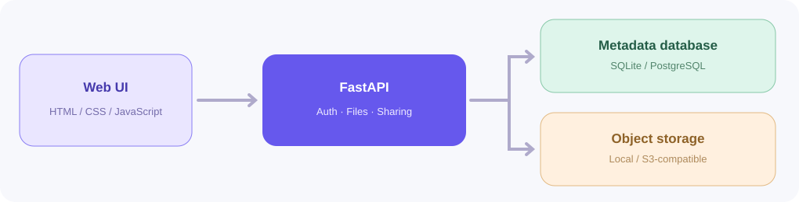

# CloudVault ☁️

**A modern cloud file storage and sharing platform built with FastAPI, SQLAlchemy, and vanilla JavaScript.**

CloudVault is a working portfolio project. Users can sign up, upload files, create nested folders, browse a responsive file manager, preview and download supported files, search, star files, move them to trash or restore them, and generate secure expiring download links. A separate private demo account is created for each visitor who chooses **Explore demo**.



## What works

- **Authentication:** email/password accounts, password hashing with scrypt, HTTP-only session cookies, CSRF-protected mutations, user-isolated data.
- **Files:** upload with progress, multiple selection, drag-and-drop, downloads, safe inline preview (images, PDFs, videos), per-file size limits, quota check, SHA-256 checksum.
- **Organization:** nested folders, breadcrumbs, list/grid layout, rename, move, search, starred files, recent activity, trash, restore, permanent delete.
- **Sharing:** opaque 256-bit bearer-link tokens (only hashed in DB), optional expiration, link revocation, public download count.
- **Storage:** local disk by default; optional **S3-compatible object storage** (including Cloudflare R2) with `STORAGE_BACKEND=s3`.
- **Database:** SQLite for local/demo; PostgreSQL via `DATABASE_URL` for persistent production deployments.
- **Deployment:** Dockerfile for a single-service deploy; `render.yaml` demonstrates a free ephemeral portfolio demo.
- **Testing:** `pytest` integration coverage for authentication, ownership isolation, CRUD, sharing, trash, and folder cycles.

## Run locally (Windows PowerShell)

```powershell
cd cloudvault
py -m venv .venv
.\.venv\Scripts\Activate.ps1
pip install -r requirements-dev.txt
uvicorn app.main:app --reload
```

Open **http://localhost:8000**. Click **Explore with a private demo account** or create an account. No API keys or external services are needed for local operation.

On macOS/Linux use `python3 -m venv .venv && source .venv/bin/activate` instead.

### Run tests

```bash
python -m pytest -q
```

### Run in Docker

```bash
docker build -t cloudvault .
docker run --rm -p 8000:10000 -e PORT=10000 cloudvault
```

The Docker container uses an ephemeral filesystem unless you mount a persistent volume. For local persistence, use `-v cloudvault-data:/tmp/cloudvault`.

## Deploy a free **demo** on Render

1. Create a new public GitHub repository and push the **contents** of the `cloudvault` folder (so `Dockerfile` is at the repository root).
2. In [Render](https://dashboard.render.com), choose **New → Web Service**, connect the repository, choose **Docker**, and use `./Dockerfile`.
3. Select **Free** if the plan is offered to your account. No extra services are required for this simplified demo.
4. Set `COOKIE_SECURE=true`. Optionally set `PUBLIC_BASE_URL=https://YOUR-SERVICE.onrender.com` so share URLs use your public origin.
5. Deploy. Test account creation, upload, refresh, download, and share link creation.

**Important:** Render's free web-service filesystem is ephemeral. This standalone demo stores both files and the SQLite database locally; they **will disappear** during restarts or redeployments. Do not use it for storing important or sensitive files. Free instances can also sleep after inactivity.

## Make it persistent (PostgreSQL + S3-compatible storage)

Configure an external PostgreSQL database and a private object-storage bucket via environment variables (example in `.env.example`):

| Variable | Meaning |
|---|---|
| `DATABASE_URL` | SQLAlchemy/PostgreSQL connection string (e.g. from your DB provider) |
| `STORAGE_BACKEND` | Set to `s3` |
| `S3_BUCKET` | Your private bucket name |
| `S3_ENDPOINT_URL` | Provider's S3-compatible API endpoint |
| `AWS_ACCESS_KEY_ID` | Storage write/read access key |
| `AWS_SECRET_ACCESS_KEY` | Storage secret |
| `AWS_DEFAULT_REGION` | Provider's region (`auto` for Cloudflare R2) |
| `COOKIE_SECURE` | Set to `true` on HTTPS |
| `PUBLIC_BASE_URL` | Your full public HTTPS site URL |
| `MAX_UPLOAD_MB` | File size limit, default 25 MB |
| `STORAGE_QUOTA_MB` | Per-account quota, default 500 MB |

**Never commit credentials or `.env` files.** The provider's bucket should remain private; files are served via authenticated API endpoints and via explicit share tokens.

## Architecture

```text
Browser (HTML/CSS/JS)
  ├── JSON API + CSRF header + HttpOnly cookie
  └── Multipart file uploads / authenticated downloads
            |
      FastAPI application
       ├── Auth + sessions
       ├── Folder/file metadata
       ├── Share links + activity
       └── Object storage adapter
            ├── Local disk (demo)
            └── S3-compatible (persistent files)
      SQLite (demo) / PostgreSQL (persistent metadata)
```

## Security and scope

This is a **portfolio/demo implementation, not a production-hardened Google Drive replacement**. It implements owner checks, secure password hashes, HttpOnly session cookies, CSRF checks, private object keys, random share tokens, and limits. Before using it commercially, add API rate limiting (especially account creation/login/demo and public downloads), antivirus scanning, a full malware/abuse prevention policy, email verification, backup/restore, observability, object cleanup on DB failures, and CDN/object egress controls. The demo account endpoint should be disabled or rate-limited in a real deployment. A link grants download access to its holder; don't send it to someone you don't trust. No client-side/end-to-end encryption is claimed.

## Example resume bullets (only after you have tested and can explain the code)

**CloudVault — Cloud File Storage Platform** | FastAPI, Python, SQLAlchemy, JavaScript, Docker, S3 API
- Built a multi-user file storage application with private user workspaces, nested folders, file search, drag-and-drop uploads, secure downloads, and a responsive dashboard.
- Implemented scrypt password hashing, cookie-based sessions, CSRF protection, ownership validation, storage quota enforcement, and time-limited revocable share links.
- Designed interchangeable local/S3-compatible object storage and SQLite/PostgreSQL metadata layers; added automated end-to-end API integration tests and Docker deployment.

## License

MIT. See `LICENSE`.
